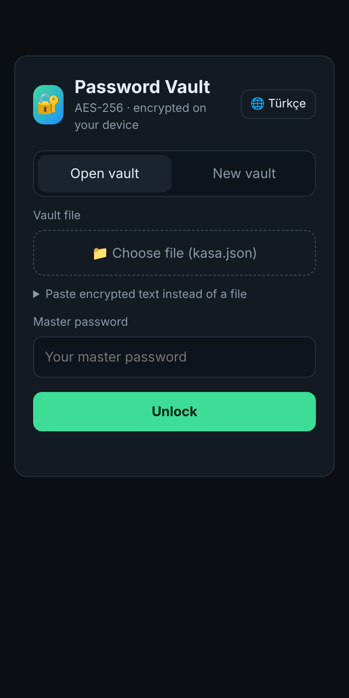
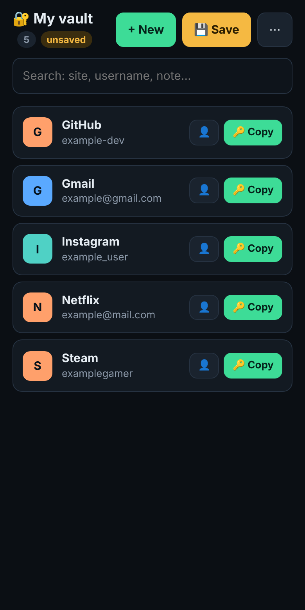

# 🔐 Password Vault (Şifre Kasası)

**[Türkçe](README.md) · English**

A single-file, zero-install password vault that runs in your browser.
Your passwords are **encrypted on your device with AES-256-GCM** and live only in an encrypted `kasa.json` file that you keep yourself. No server, no account, no tracking.

**Try it:** https://wolkansezer.github.io/sifre-kasasi/

<p align="center">
  
  &nbsp;&nbsp;
  
</p>

<sub>The entries in the screenshots are examples.</sub>

## Why?

Ready-made password managers are great, but sometimes you want full control: knowing exactly where your data lives, being able to read all the code in one file, and keeping your vault on whatever storage you like (Google Drive, iCloud, a USB stick). Password Vault was built for that.

## Features

- **End-to-end encryption**: AES-256-GCM, with the key derived from your master password using PBKDF2-SHA256 at **600,000 iterations**
- **Fully local**: Encryption and decryption happen on your device through the browser's Web Crypto API; the page cannot connect anywhere (CSP `connect-src 'none'`)
- **Single file**: HTML, CSS and JavaScript in one `index.html`, no external libraries
- **Strong password generator** with length and symbol options and a strength meter
- **One-tap copy**: The clipboard is cleared automatically after 30 seconds
- **Auto-lock** after 5 minutes of inactivity
- **Search** across titles, websites, usernames and notes
- **CSV import** from Chrome, Edge, Bitwarden and other exports
- **Change master password**
- **Mobile friendly**: Add it to the home screen on iPhone and Android
- **Turkish and English interface** (switch with the 🌐 button), dark theme

## Usage

### Online
Open **https://wolkansezer.github.io/sifre-kasasi/**

### Offline
Download `index.html` and open it in your browser. No internet needed.

### First setup
1. On the **New vault** tab, set your master password.
2. Add your entries and press **💾 Save**; `kasa.json` is downloaded.
3. Put this file on Google Drive, iCloud Drive or wherever you like.

### Next time
**Open vault** → choose `kasa.json` → enter your master password. After making changes, save and overwrite the old file.

### Syncing between phone and computer
Syncing works through the file: open and save the same `kasa.json` on Drive from both devices. On a computer with *Google Drive for Desktop*, saving into the Drive folder is enough. Don't edit on two devices at the same time; the last saved file wins.

## Security

| | |
|---|---|
| Encryption | AES-256-GCM (new 96-bit IV on every save) |
| Key derivation | PBKDF2-HMAC-SHA256, 600,000 iterations, 128-bit random salt |
| Randomness | `crypto.getRandomValues` |
| Network access | None (blocked by Content-Security-Policy) |
| Storage | Only the user's own `kasa.json` file |

Vault file format:

```json
{ "app": "sifre-kasasi", "v": 1, "kdf": "PBKDF2-SHA256", "iter": 600000,
  "salt": "…", "iv": "…", "ct": "…" }
```

> ⚠️ **If you forget your master password, there is no way to open the vault.** Write it down, keep it somewhere safe, and keep backups of your vault file.

> ℹ️ This project was built for personal use and has not been independently security audited. For critical use, also consider audited solutions such as Bitwarden or KeePassXC.

## License

[MIT](LICENSE)
