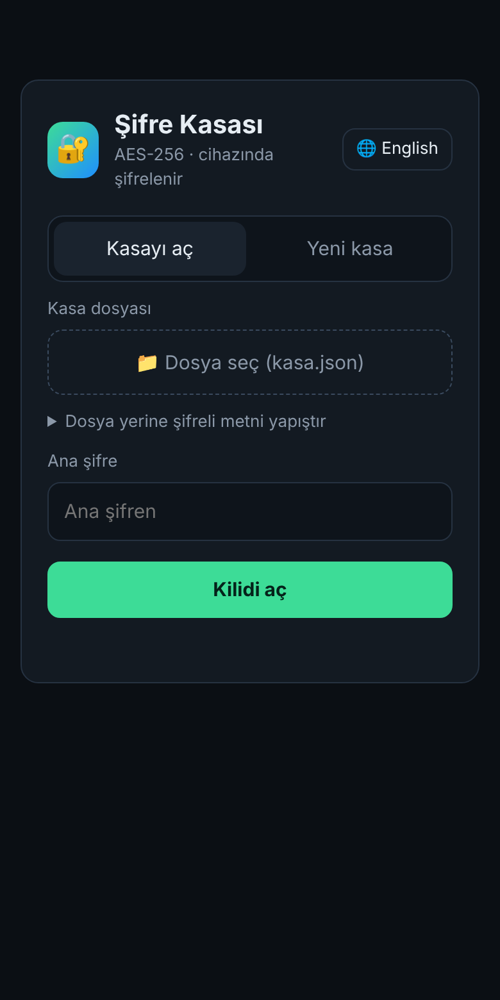
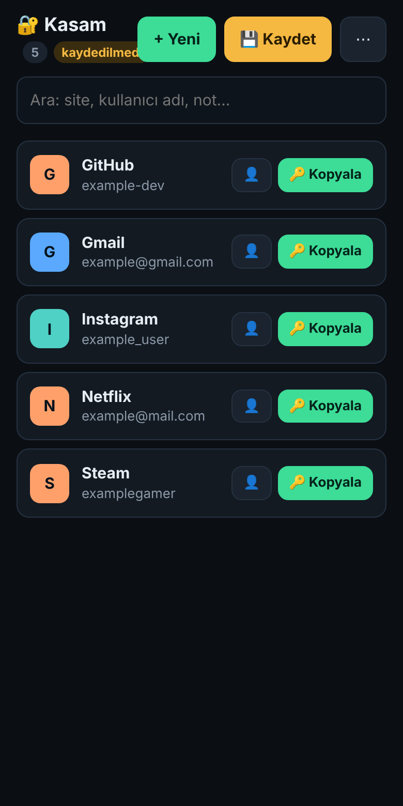
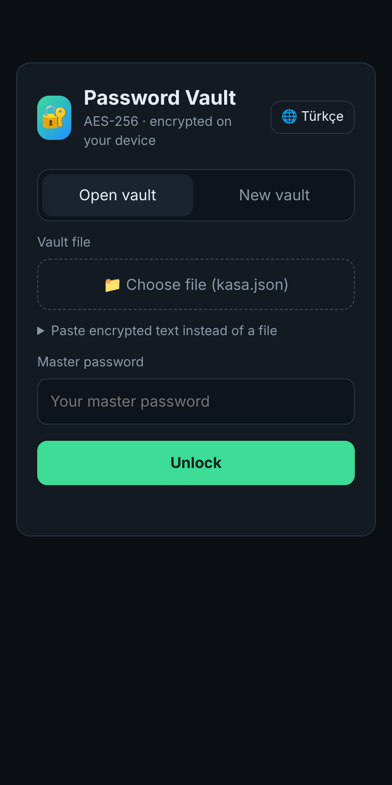
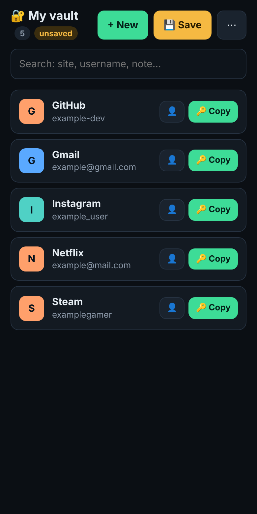

# 🔐 Şifre Kasası · Password Vault

**[🇹🇷 Türkçe](#turkce) · [🇬🇧 English](#english)**

Tarayıcıda çalışan, tek dosyalık, kurulum gerektirmeyen kişisel şifre kasası.
*A single-file, zero-install password vault that runs in your browser.*

**Hemen dene / Try it:** https://wolkansezer.github.io/sifre-kasasi/

<table align="center">
  <tr>
    <th colspan="2">🇹🇷 Türkçe</th>
    <th colspan="2">🇬🇧 English</th>
  </tr>
  <tr>
    <td></td>
    <td></td>
    <td></td>
    <td></td>
  </tr>
</table>

<sub>Ekran görüntülerindeki kayıtlar örnektir. · The entries in the screenshots are examples.</sub>

---

<a id="turkce"></a>

## 🇹🇷 Türkçe

Şifreler **cihazında AES-256-GCM ile şifrelenir** ve sadece senin sakladığın şifreli bir `kasa.json` dosyasında durur. Sunucu yok, hesap yok, takip yok.

### Neden?

Hazır şifre yöneticileri harika ama bazen tam kontrol istersin: verinin nerede durduğunu bilmek, kodun tamamını tek dosyada okuyabilmek ve kasayı istediğin buluta (Google Drive, iCloud, USB bellek) koyabilmek. Şifre Kasası bunun için yapıldı.

### Özellikler

- **Uçtan uca şifreleme**: AES-256-GCM, anahtar ana şifreden PBKDF2-SHA256 ile **600.000 turda** türetilir
- **Tamamen yerel**: Şifreleme ve çözme tarayıcının Web Crypto API'si ile cihazında yapılır; sayfa hiçbir yere bağlanamaz (CSP ile `connect-src 'none'`)
- **Tek dosya**: HTML, CSS ve JavaScript tek `index.html` içinde, dış kütüphane yok
- **Güçlü şifre üretici**: Uzunluk ve sembol seçimiyle, şifre gücü göstergesi
- **Tek tuşla kopyalama**: Pano 30 saniye sonra otomatik temizlenir
- **Otomatik kilit**: 5 dakika işlem yapılmazsa kasa kilitlenir
- **Arama**: Başlık, adres, kullanıcı adı ve notlarda
- **Toplu içe aktarma**: iPhone/Safari ZIP dosyası, Chrome, Edge, Firefox, Google hesabı ve Mac dışa aktarımları tek seferde; ya da metin olarak yapıştır. Aynı kayıtları atlar, değişen şifreleri günceller
- **Ana şifre değiştirme**
- **Mobil uyumlu**: iPhone ve Android'de ana ekrana eklenebilir
- **Türkçe ve İngilizce arayüz** (🌐 butonuyla değiştirilir), koyu tema

### Kullanım

**Çevrimiçi:** GitHub Pages adresini aç: **https://wolkansezer.github.io/sifre-kasasi/**

**Çevrimdışı:** `index.html` dosyasını indir ve tarayıcıda aç. İnternet gerekmez.

**İlk kurulum**
1. **Yeni kasa** sekmesinden ana şifreni belirle.
2. Kayıtlarını ekle ve **💾 Kaydet**'e bas, `kasa.json` iner.
3. Bu dosyayı Google Drive, iCloud Drive ya da istediğin yere koy.

**Sonraki kullanımlar:** **Kasayı aç** → `kasa.json` dosyasını seç → ana şifreni gir. Değişiklikten sonra kaydedip eski dosyanın üzerine yaz.

**Telefon ve bilgisayar arasında eşitleme:** Senkronizasyon dosya üzerinden yapılır: her iki cihazda da Drive'daki aynı `kasa.json` dosyasını aç ve kaydet. Bilgisayarda *Google Drive for Desktop* kullanırsan Drive klasörüne kaydetmek yeterlidir. Aynı anda iki cihazda düzenleme yapma; son kaydedilen dosya geçerli olur.

### Güvenlik

| | |
|---|---|
| Şifreleme | AES-256-GCM (her kaydetmede yeni 96 bit IV) |
| Anahtar türetme | PBKDF2-HMAC-SHA256, 600.000 tur, 128 bit rastgele tuz |
| Rastgelelik | `crypto.getRandomValues` |
| Ağ erişimi | Yok (Content-Security-Policy ile engelli) |
| Saklama | Sadece kullanıcının kendi `kasa.json` dosyası |

> ⚠️ **Ana şifreni unutursan kasayı açmanın hiçbir yolu yoktur.** Kâğıda yazıp güvenli bir yerde sakla ve kasa dosyanın yedeğini tut.

> ℹ️ Bu proje kişisel kullanım için geliştirilmiş açık kaynaklı bir çalışmadır ve bağımsız bir güvenlik denetiminden geçmemiştir. Kodun tamamı tek dosyada olduğu için herkes inceleyebilir. Yazılım olduğu gibi sunulur; kullanım sorumluluğu kullanıcıya aittir. Kasa dosyanın düzenli yedeğini almanı öneririz.

---

<a id="english"></a>

## 🇬🇧 English

Your passwords are **encrypted on your device with AES-256-GCM** and live only in an encrypted `kasa.json` file that you keep yourself. No server, no account, no tracking.

### Why?

Ready-made password managers are great, but sometimes you want full control: knowing exactly where your data lives, being able to read all the code in one file, and keeping your vault on whatever storage you like (Google Drive, iCloud, a USB stick). Password Vault was built for that.

### Features

- **End-to-end encryption**: AES-256-GCM, with the key derived from your master password using PBKDF2-SHA256 at **600,000 iterations**
- **Fully local**: Encryption and decryption happen on your device through the browser's Web Crypto API; the page cannot connect anywhere (CSP `connect-src 'none'`)
- **Single file**: HTML, CSS and JavaScript in one `index.html`, no external libraries
- **Strong password generator** with length and symbol options and a strength meter
- **One-tap copy**: The clipboard is cleared automatically after 30 seconds
- **Auto-lock** after 5 minutes of inactivity
- **Search** across titles, websites, usernames and notes
- **Bulk import**: iPhone/Safari ZIP, Chrome, Edge, Firefox, Google account and Mac exports in one go, or paste as text. Skips duplicates and updates changed passwords
- **Change master password**
- **Mobile friendly**: Add it to the home screen on iPhone and Android
- **Turkish and English interface** (switch with the 🌐 button), dark theme

### Usage

**Online:** Open **https://wolkansezer.github.io/sifre-kasasi/**

**Offline:** Download `index.html` and open it in your browser. No internet needed.

**First setup**
1. On the **New vault** tab, set your master password.
2. Add your entries and press **💾 Save**; `kasa.json` is downloaded.
3. Put this file on Google Drive, iCloud Drive or wherever you like.

**Next time:** **Open vault** → choose `kasa.json` → enter your master password. After making changes, save and overwrite the old file.

**Syncing between phone and computer:** Syncing works through the file: open and save the same `kasa.json` on Drive from both devices. On a computer with *Google Drive for Desktop*, saving into the Drive folder is enough. Don't edit on two devices at the same time; the last saved file wins.

### Security

| | |
|---|---|
| Encryption | AES-256-GCM (new 96-bit IV on every save) |
| Key derivation | PBKDF2-HMAC-SHA256, 600,000 iterations, 128-bit random salt |
| Randomness | `crypto.getRandomValues` |
| Network access | None (blocked by Content-Security-Policy) |
| Storage | Only the user's own `kasa.json` file |

> ⚠️ **If you forget your master password, there is no way to open the vault.** Write it down, keep it somewhere safe, and keep backups of your vault file.

> ℹ️ This is an open-source project built for personal use and has not been independently security audited. All of the code is in a single file, so anyone can review it. The software is provided as is, and you use it at your own responsibility. We recommend keeping regular backups of your vault file.

---

### Kasa dosyası biçimi · Vault file format

```json
{ "app": "sifre-kasasi", "v": 1, "kdf": "PBKDF2-SHA256", "iter": 600000,
  "salt": "…", "iv": "…", "ct": "…" }
```

### Lisans · License

[MIT](LICENSE)
